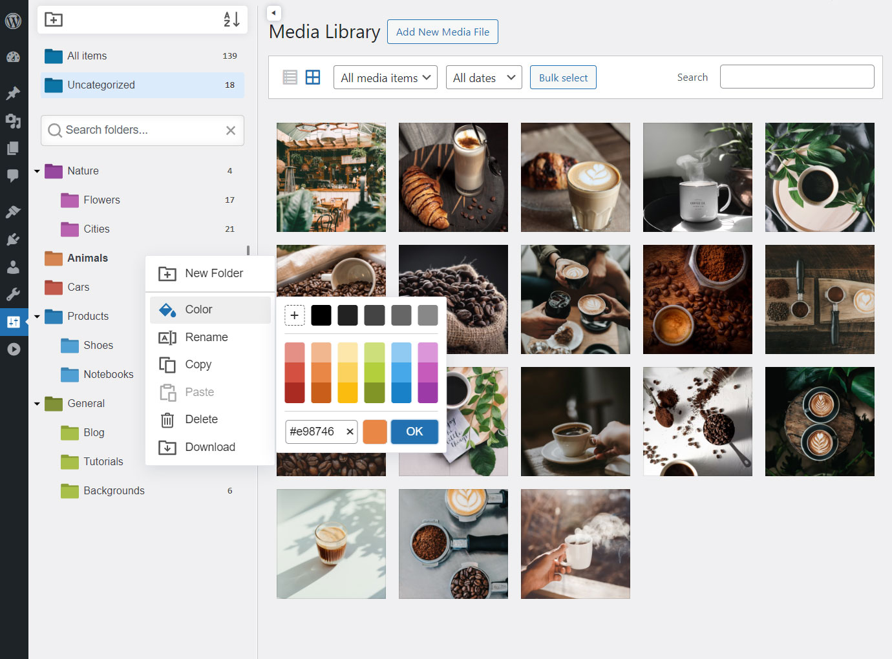

# MediaCommander - Bring Folders to WordPress Media, Posts, and Pages

Organize your WordPress media library, posts, and pages into unlimited
folders and subfolders with a fast, drag & drop folder manager built
right into the admin interface.

## About this repository

This repository contains the **exact free version published on [WordPress.org](https://wordpress.org/plugins/mediacommander/)** - the JS and CSS assets here are intentionally **not minified or obfuscated**, so you can read and audit every line the plugin runs on your site. The Pro version is distributed separately via [yalogica.com](https://yalogica.com/mediacommander/).

## Description

MediaCommander is a WordPress plugin that brings a folder tree to the media library and the users list, no coding required. A resizable sidebar lets you create folders and subfolders, drag & drop items in bulk, color-code folders, search, and upload files straight into the selected folder. Folders are fully virtual: the plugin never moves or changes your data in the uploads directory.

- [Documentation](https://yalogica.com/docs/mediacommander/)
- [How to Create Folders in WordPress Media Library](https://yalogica.com/blog/how-to-create-folders-in-wordpress-media-library/)
- [Upgrade to Pro](https://yalogica.com/mediacommander/)

### Free version highlights

- Unlimited folders and subfolders
- Folders for the Media Library and Users
- Works in Gutenberg (block editor) and Classic Editor
- Personal or shared folders for users
- Drag & drop with bulk operations
- Color folders and smart delete
- Search & filter with keywords and wildcards
- Direct upload into the selected folder
- Download folders as ZIP with their structure
- Import folders from FileBird and Real Media Library
- Image gallery block for the block editor

**MediaCommander Pro** adds folders for posts, pages and custom post types, advanced folder access rules per role/user, custom folder sorting, default folder color configuration, hidden folder item counters, and customizable media hover info.

## Installation

The canonical, always-up-to-date build lives in the WordPress.org directory:

1. In your WordPress admin, go to **Plugins → Add New**.
2. Search for "MediaCommander".
3. Click **Install Now**, then **Activate**.

Or download the installable zip directly from
[wordpress.org/plugins/mediacommander](https://wordpress.org/plugins/mediacommander/).

## Support

- **Usage & installation help:** use the [WordPress.org support forum](https://wordpress.org/support/plugin/mediacommander/) - this is the fastest way to get an answer.
- **GitHub Issues:** for reproducible bugs in the source code published in this repository only.